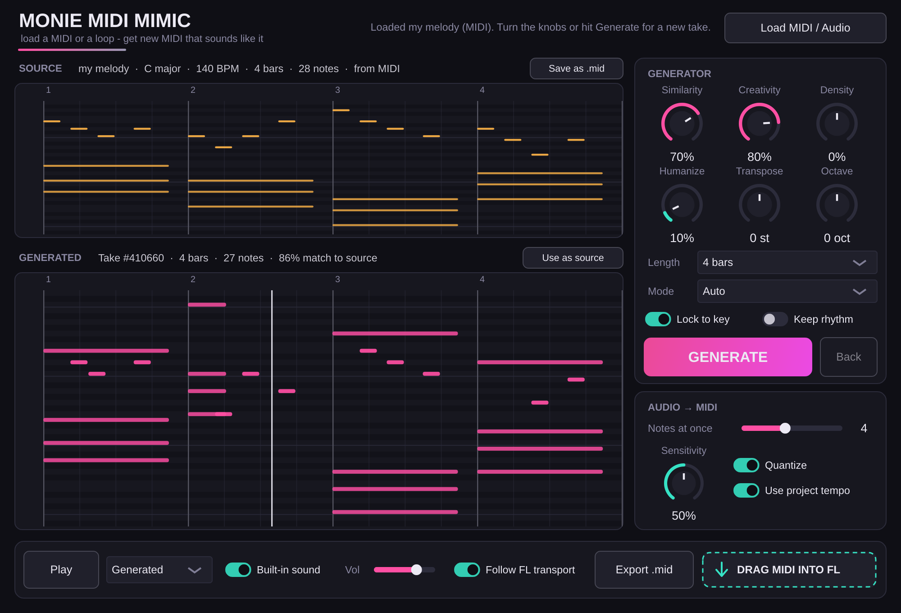

# Monie MIDI Mimic

A VST3 instrument for FL Studio (Windows 11, 64-bit). Load a MIDI file **or** a piece of
audio, and it writes new MIDI in the same style: same key, same groove, similar melodic
moves and chord shapes. Turn the knobs to decide how close or how loose it stays, then
drag the result straight into FL or export a `.mid`.



## What it does

- **Load** a `.mid`, or a `.wav` / `.mp3` / `.flac` / `.aiff` / `.ogg` (drop it on the window or click *Load MIDI / Audio*).
  Audio is converted to MIDI first: pitched mode finds melody / bass / chords, drum mode finds kick, snare and hi-hat.
- **Generate** a new take. It learns from your source:
  - the key and scale (and keeps every note in key if *Lock to key* is on)
  - where in the bar notes land (the groove) and how long they ring
  - how the melody moves from note to note, and the chord shapes you use
  - which bars repeat, so loops stay loop-like
  - for drums: each drum's pattern, velocities, plus hi-hat rolls and fills
- **Hear it**: press FL's play (it follows the song position and loops the clip), or the plugin's own *Play*.
  It has a simple built-in sound and also sends the MIDI out.
- **Use it**: drag the *DRAG MIDI INTO FL* pad onto the Channel Rack, Playlist or a Piano roll, or *Export .mid*.
- Everything is saved inside your FL project: reopen it and the same source and take are still there.

## Install

### Option 1: let GitHub build it (no Visual Studio needed)

1. Make a free GitHub account, create a new repository, and upload this whole folder
   (including the hidden `.github` folder - on github.com use *Add file > Upload files* and drag the folder in).
2. Open the repository's **Actions** tab. The *Build Windows VST3* job starts by itself
   (or click it, then *Run workflow*). It takes about 10 minutes.
3. When it's green, open the run and download **MonieMidiMimic-Windows-x64** at the bottom.
4. Unzip it and double-click **install.bat** (it asks for admin permission to copy into
   `C:\Program Files\Common Files\VST3`).

### Option 2: build it on your PC

1. Install [Visual Studio Community](https://visualstudio.microsoft.com/) with the workload
   **Desktop development with C++**, and [Git](https://git-scm.com/download/win).
2. Double-click **build.bat**. The first build downloads JUCE and takes a few minutes.
3. Double-click **install.bat**.

### Then, in FL Studio

1. *Options > Manage plugins > Find installed plugins* (tick *Verify plugins* if it doesn't show up).
2. Channel Rack **+** > **Monie MIDI Mimic**.

There's also `Monie MIDI Mimic.exe`, a standalone version that works without FL.

## Using it

| Control | What it does |
|---|---|
| **Similarity** | How close the new take stays to the source. ~90% = small variations, ~50% = same vibe, new notes, ~15% = loosely inspired. |
| **Creativity** | How adventurous the choices are (bigger leaps, rarer rhythms, more hi-hat rolls and fills). |
| **Density** | Left = fewer notes, right = busier. |
| **Humanize** | Loosens timing and velocity so it feels played. |
| **Transpose / Octave** | Move the result. Ignored for drums. |
| **Length** | Same as the source, or 1-32 bars. |
| **Mode** | *Auto* uses drum mode for channel-10 MIDI or audio files named like `drum`, `kick`, `hat`, `perc`, `break`. Force *Melodic* or *Drums* here. |
| **Lock to key** | Every note stays in the detected key. |
| **Keep rhythm** | Keep the exact source rhythm and only change notes (drums: keeps the kick pattern). |
| **GENERATE / Back** | New take each click / go back to the previous one. Knob changes re-make the current take live. |
| **Use as source** | Make the current take the new source, to keep evolving an idea. |
| **Save as .mid** (source) | Save the source, handy for keeping an audio-to-MIDI conversion. |

**Audio to MIDI settings** (apply the next time you load audio):
*Notes at once* (1 = melody or bass line, 3-4 = chords), *Sensitivity* (higher catches quieter notes, and more mistakes),
*Quantize* (snap to 1/16), *Use project tempo* (use FL's BPM instead of detecting it - leave this on when your loop matches the project tempo).

### Sending the MIDI to another instrument

Turn **Built-in sound** off, then in the plugin's wrapper (gear icon) set a MIDI **output port**
(for example 1), and set the same number as the **input port** on the instrument you want to play.
Or just drag the clip into that instrument's Piano roll.

### Tips

- Short, clean sources work best: a 2-8 bar loop rather than a whole song.
- For audio, a solo instrument or drum loop transcribes far better than a full mix.
  A full mix still gives a usable sketch, especially with *Notes at once* = 1 (melody or bass).
- If a drum loop comes out as notes, set *Mode* to *Drums* and load it again.

## How it works (short version)

- **Analysis** - notes that start together become chords. It detects the key
  (Krumhansl-Kessler profiles), the quantize grid, how likely a note is on each step of the
  bar, note lengths, chord shapes, and builds a Markov chain of melodic intervals.
- **Generation** - bar by bar it either copies a source bar and mutates it (drop / shift /
  split / add notes, re-pick pitches near the original) or draws a fresh bar from the learned
  groove; pitches come from the interval chain, weighted toward the pitch classes you use and
  kept in key and in range. Similarity sets how often each of those happens.
  Drums use a per-drum, per-step probability blend of the original pattern and its statistics.
- **Audio to MIDI** - pitched: an FFT with harmonic summation finds the strongest pitches each
  frame, then tracks them into notes (splitting re-attacks at onsets). Drums: onset detection in
  kick, snare and hat frequency bands, with checks so one drum bleeding into another band
  doesn't create a fake hit. Tempo comes from FL (or autocorrelation of the onsets).

## Project layout

```
Source/Engine/   Phrase, MidiIO (read/write .mid), Generator (style model), AudioToMidi
Source/          PluginProcessor (playback, state), PluginEditor (UI), PianoRoll, PreviewSynth, look and feel
Tests/           EngineTests (headless engine checks), HostTest (loads the VST3, plays it, renders the UI)
build.bat        local Windows build      install.bat   copies the plugin into the VST3 folder
.github/         GitHub Actions workflow that builds the Windows plugin
```

Build options: `-DMIMIC_BUILD_TESTS=ON` builds the engine tests, `-DMIMIC_BUILD_HOST_TEST=ON` the host test,
`-DJUCE_DIR=path` uses a local JUCE checkout instead of downloading JUCE 8.0.4.
JUCE is used under its AGPLv3 / commercial licence terms; check them before selling the plugin.
